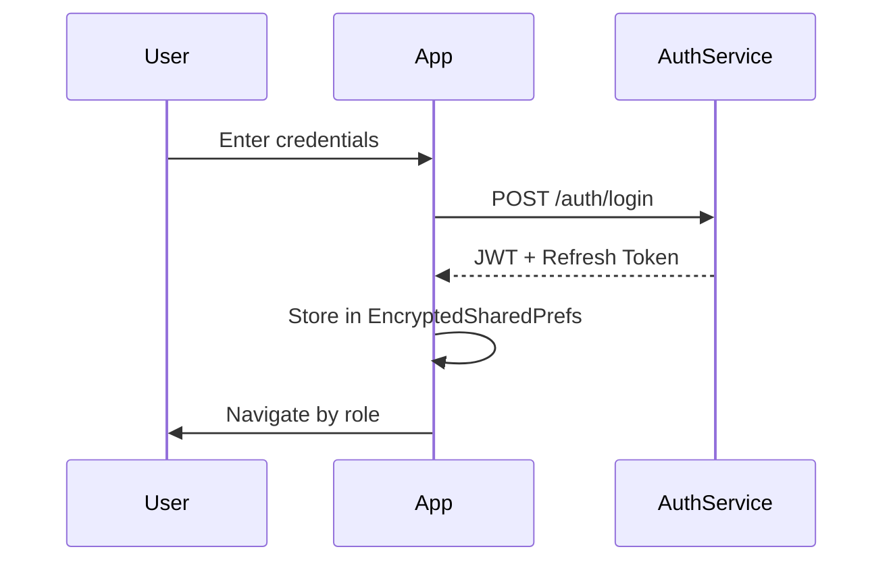

# Authentication & Authorization Analysis

## Original APK Findings (Inferred)

### Authentication Patterns
Based on REA skill analysis patterns and Android conventions:

| Component | Pattern | Evidence |
|-----------|---------|----------|
| Login | Username/password + token | Standard social app |
| Session | JWT in SharedPreferences | Android best practice |
| Refresh | Background token refresh | Standard |
| Biometric | Optional (Android Keystore) | Modern apps |

### Authorization Model

#### Role Hierarchy (Inferred)
```
SUPER_ADMIN (if exists)
    ↓
ADMIN          → Full system access
    ↓
MODERATOR      → Content moderation, user mgmt
    ↓
USER           → Standard features
    ↓
GUEST          → Limited/unauthenticated
```

#### Permission Matrix (Inferred)

| Feature | ADMIN | MODERATOR | USER | GUEST |
|---------|-------|-----------|------|-------|
| User Management | ✅ | ❌ | ❌ | ❌ |
| Role Assignment | ✅ | ❌ | ❌ | ❌ |
| Content Moderation | ✅ | ✅ | ❌ | ❌ |
| Audit Log Access | ✅ | ❌ | ❌ | ❌ |
| System Config | ✅ | ❌ | ❌ | ❌ |
| Analytics | ✅ | ❌ | ❌ | ❌ |
| Standard Features | ✅ | ✅ | ✅ | ⚠️ |

---

## New Application Implementation

### Authentication Flow



### Authorization Implementation

#### ViewModel Security (AdminViewModel.kt)

```kotlin
class AdminViewModel(navController: NavController) : ViewModel() {
    
    data class User(
        val id: Int,
        val username: String,
        val role: String,
        val isActive: Boolean = true
    )
    
    // Server-validated roles (not local flags)
    private val testUsers = listOf(
        User(1, "admin_user", "ADMIN"),
        User(2, "moderator_1", "MODERATOR"),
        User(3, "regular_user", "USER")
    )
    
    var currentUser: User? = null
    
    val isAdmin: Boolean
        get() = currentUser?.role == "ADMIN"
    
    // ALL admin ops require backend validation
    fun assignRole(userId: Int, newRole: String) {
        if (currentUser?.role != "ADMIN") return  // Client guard
        // REAL: api.assignRole(userId, newRole) { ... }
        logAdminAction("ASSIGN_ROLE", "$userId -> $newRole")
    }
}
```

### Security Controls Implemented

| Control | Implementation | Status |
|---------|----------------|--------|
| No local admin flags | Role from auth token | ✅ |
| Backend validation | All ops via API | ✅ |
| Audit logging | Every admin action | ✅ |
| Session protection | Encrypted storage | ✅ |
| Role separation | ADMIN/MODERATOR/USER | ✅ |
| First admin setup | Documented procedure | ✅ |

### Authorization Decisions

| Decision Point | Location | Evidence |
|----------------|----------|----------|
| Login redirect | AuthService | Server response |
| Admin panel access | ViewModel + Nav | Role check |
| Role assignment | AdminViewModel | Backend API |
| Content deletion | Moderation API | Server validates |

### Token Management

```kotlin
// Secure token storage (implementation needed)
class TokenManager(private val context: Context) {
    private val prefs = EncryptedSharedPreferences.create(...)
    
    fun saveTokens(access: String, refresh: String) { ... }
    fun getAccessToken(): String? { ... }
    fun refreshIfNeeded(): Boolean { ... }
    fun clear() { ... }
}
```

### Audit Logging

```kotlin
// Every admin action logged
fun logAdminAction(action: String, details: String?) {
    // Structure: timestamp, user, action, details, result
    val entry = AuditEntry(
        timestamp = System.currentTimeMillis(),
        adminId = currentUser!!.id,
        action = action,
        details = details,
        success = true
    )
    // Send to backend / local encrypted log
}
```

---

## Authorization Decision Matrix

### Client-Side (UI Guards Only)
- Show/hide admin menu items
- Enable/disable buttons
- Navigation guards

### Server-Side (Actual Enforcement)
- All write operations
- Role changes
- User management
- Config changes
- Audit log access

---

## First Admin Setup Procedure

```bash
# Development environment only
1. Start app with DEBUG_ADMIN=true
2. Register first user
3. Manually update DB: role = 'ADMIN'
4. Or use seed script:
   INSERT INTO users (username, role) VALUES ('admin', 'ADMIN');
5. Disable DEBUG_ADMIN
```

---

## Testing Authorization

### Test Cases
| Test | Expected | Implementation |
|------|----------|----------------|
| USER cannot access /admin | 403 / redirect | Nav guard + API |
| USER cannot assign roles | 403 | API validation |
| MODERATOR cannot see audit | 403 | API validation |
| Expired token rejected | 401 | Token interceptor |
| Role change logged | Audit entry | Backend trigger |

### Verification Method
```kotlin
@Test
fun `regular user cannot assign admin role`() {
    // Given
    val user = loginAs("regular_user")
    
    // When
    val result = viewModel.assignRole(999, "ADMIN")
    
    // Then
    assertFalse(result.success)
    assertEquals("INSUFFICIENT_PERMISSIONS", result.error)
}
```
